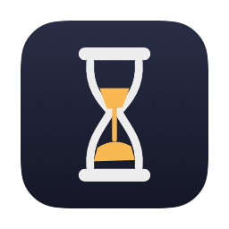
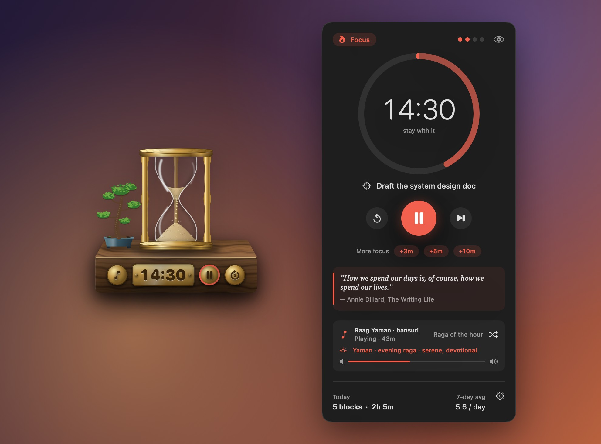
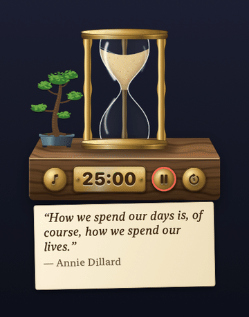
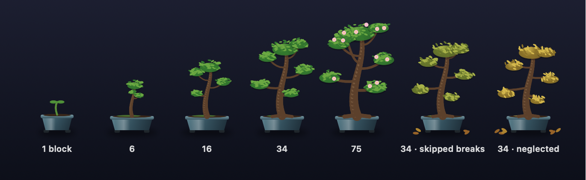
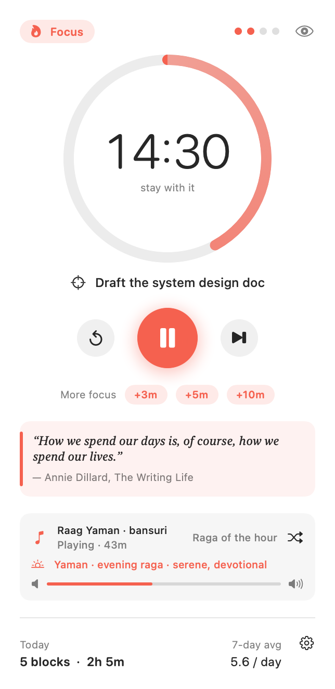
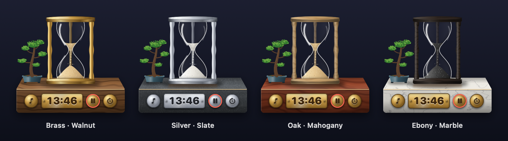
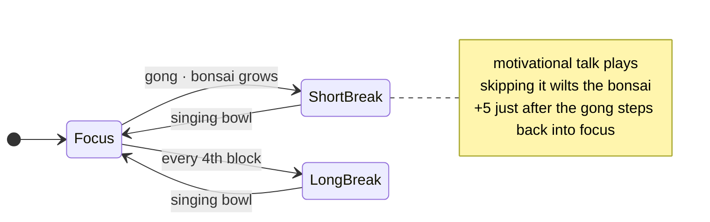

<div align="center">



# Pomo

**A Pomodoro timer for macOS that sits on your desk as a brass hourglass and lets the sand do the counting.**

A bonsai that grows with every focus block. A gong when the block ends, a singing bowl when the break is over.<br>
Music that follows the clock, and a command line for people who live in the terminal.




</div>

## Highlights

- **⏳ The sand is the timer.** A floating, always-on-top hourglass drains as you work, then lifts and flips over when the phase ends.
- **🌳 A bonsai that grows with your focus.** Every finished block makes it grow. Skip your breaks and it starts to wilt.
- **🎵 Sound that follows the clock.** Focus music during blocks (including a raga picked for the time of day), a short motivational talk during breaks, and a gong and a singing bowl at the changeovers.
- **⏱ Built for flow.** Set an intention for each block, and add *just a few more minutes* when the timer ends at the wrong moment.
- **⌨️ Terminal first.** Run `pomo start "refactor the ingestion job"` from any shell. A `pomo://` URL scheme lets scripts, Raycast and Shortcuts control it too.
- **🪶 Small and self-contained.** About 3k lines of Swift with no dependencies or analytics. The hourglass and bonsai are drawn in code, and the sounds, textures and icon come from generator scripts in `tools/`.

---

<details>
<summary><b>New to the Pomodoro Technique? What it is and why it works</b></summary>

The Pomodoro Technique is a time-management method created by **Francesco Cirillo** in the late 1980s, when he was a university student. He timed his study sessions with a tomato-shaped kitchen timer, and *pomodoro* is Italian for "tomato". It has four steps:

1. **Pick one task.**
2. **Work on only that task for 25 minutes.** That's one *pomodoro*.
3. **Take a 5-minute break.**
4. **After four pomodoros, take a longer break** of 15–30 minutes.

**Why it works**

- **Starting gets easier.** "Write the report" feels heavy, but "work on it for 25 minutes" doesn't. A short, fixed block lowers the barrier to getting going.
- **One thing at a time.** Each pomodoro belongs to a single task. Switching tasks costs attention. Once the timer is running the decision is already made, so you stop renegotiating with yourself.
- **Breaks are part of the method.** Regular short breaks counter the slow drain of long, unbroken sessions. You come back to the work with fresher eyes.
- **Time becomes visible.** Counting pomodoros shows how long things really take. That's the first step to estimating better and protecting your focus time.
- **Momentum.** Finished blocks pile up during the day, and small wins are motivating.

Pomo is designed so you never think about the method itself. You **see** time passing, you **hear** each block start and end, and you never need to check a clock.

</details>

---

## A tour

### ⏳ An hourglass on your desk



A desk ornament floats above every app and Space. It's a polished-brass hourglass on a walnut plinth, and **the sand is the timer**. The top bulb empties into a funnel, grains fall through the neck, and a cone builds up below.

When a phase ends, the hourglass **lifts off the table and flips over** to start the next one. Click the glass to start a block, or to end a break early.

Brass fittings on the plinth hold the controls:

- an engraved plate showing the time
- a knob for music
- a knob for pause
- a **⟳5** knob that adds five more minutes

A parchment slip underneath shows the current quote.

You can drag it anywhere and resize it from 70% to 180%. When you're about to present, press **⌃⌥P** to hide it. The timer and music keep running.

<br clear="right">

### 🌳 A bonsai that grows with your focus

<p align="center"></p>

A small tree in a glazed pot stands beside the hourglass. Every finished focus block helps it grow, from **sprout** to **sapling** to **young tree** to **bonsai**. After 60 blocks it **blossoms**.

Breaks matter as much as the work. If you skip them, the tree droops, yellows and drops leaves on the table. Take them again and it recovers. Hover over it to see its stage, how far it is from the next one, and its health.

### 🎵 Sound that follows the clock

- **🔔 Gong and singing bowl.** A deep gong ends each focus block and a singing bowl calls you back from the break. Both are synthesized from scratch.
- **🎶 Focus music.** When a block starts, Pomo plays a long track or DJ set from YouTube. The music fades out at the gong and continues where it left off in the next block.
- **📣 Motivational talks in breaks.** Each break plays a different 3–15 minute talk on discipline, running or mindset. The focus music returns when the next block starts.

| Mood | Plays things like… |
|---|---|
| **Raga of the hour** | Bansuri ragas chosen by Hindustani time theory: **Bhairav** at dawn, **Todi** in the morning, **Bhimpalasi** in the afternoon, **Marwa** at sunset, **Yaman** in the evening, **Malkauns** late at night |
| **Nature** | Flowing streams, ocean waves, forest and rain ambience |
| **Bansuri & flute** | Indian classical flute, Hariprasad Chaurasia |
| **Shamanic** | Drum-and-flute journeys, handpan |
| **Sunset sets** | Melodic house, melodic techno, progressive psytrance |

To use the music:

- **Choose a mood.** Pick one of the moods above, or **Mix** to draw from all of them. Pomo picks a track at random.
- **Change the track.** Press ⇄ to skip to another one, or open it on YouTube.
- **Write your own moods.** Each mood is just a set of search queries ([Customise](#customise)).

### ⏱ Built for flow

<picture align="right"><source media="(prefers-color-scheme: dark)" srcset="docs/window-dark.png"></picture>

- **Intention.** Each block starts with *"What will you focus on?"* Your answer stays on screen while you work.
- **"Just a few more minutes."** Add time without breaking your stride:
  - **Where:** **+3 / +5 / +10** in the window, the **⟳5** knob, **+5 min more** on the end-of-phase notification, or `pomo +5` in the terminal.
  - **Right after a block ends**, it steps you back into that block, and the extra minutes are logged.
- **Quotes.** More than 30 quotes with checked attributions, including Seneca, Marcus Aurelius, Hamming, Feynman, Knuth and Annie Dillard. None repeats until you've seen them all.
- **Daily summary.** Each evening a notification lists your blocks, minutes focused, what you worked on and your 7-day average. There are no streaks, because guilt is a bad motivator.
- **Dock and ⌘-Tab.** Pomo behaves like any other app, and its Dock icon shows the minutes left.

<br clear="right">

### 🎨 Make it yours

In Settings you can choose:

- **Hourglass frame:** brass, silver, oak, walnut, ebony or mahogany
- **Table:** walnut, oak, ebony, mahogany, slate or marble
- **Sand:** golden, white, rose or obsidian

<p align="center"></p>

### ⌨️ Terminal first

```console
$ pomo start "refactor the ingestion job"
▶ focus 25:00  — refactor the ingestion job   (today: 3 blocks, 75m)
   ♪ ▶ Raag Yaman · Hariprasad Chaurasia

$ pomo +5                   # five more minutes (or: pomo extend 3)
$ pomo pause | resume | skip | reset | status
$ pomo hide | show          # or ⌃⌥P from anywhere
$ pomo video on | off       # show or hide the YouTube video (sound keeps playing)
$ pomo size 140             # resize the hourglass (70–180%)
```

`pomo` talks to the app through the `pomo://` URL scheme, so anything that can open a URL can drive it: shell scripts, tmux panes, Raycast and Shortcuts.

---

## How the timer works



## Install

You need **macOS 14 or later** and the **Xcode Command Line Tools** (`xcode-select --install`). You don't need the full Xcode app.

```bash
git clone https://github.com/shameerW/pomo.git
cd pomo
./build.sh                     # compiles, installs ~/Applications/Pomo.app and launches it
mkdir -p ~/.local/bin && ln -s "$PWD/pomo" ~/.local/bin/pomo   # optional: the `pomo` command (add ~/.local/bin to PATH)
```

There's no prebuilt download. You build it yourself in about 30 seconds, so Gatekeeper never gets involved.

On first launch, allow notifications when macOS asks. Opening Pomo from Applications or Spotlight shows its window. The floating hourglass appears while a timer is running.

To uninstall:

```bash
rm -rf ~/Applications/Pomo.app ~/Library/Application\ Support/Pomo ~/.local/bin/pomo
defaults delete com.shameerw.pomo
```

## Customise

| What | Where |
|---|---|
| Durations, auto-start, quotes, music, break talks, desk bonsai, hourglass frame, table, sand and size, summary time, launch at login, Dock icon | the ⚙︎ gear in the window |
| Video player on/off, YouTube API key | the ⚙︎ gear in the window (the player also has its own hide button) |
| Your own quotes | `~/Library/Application Support/Pomo/quotes.json`: `{"focus": [{"text": "…", "author": "…"}], "rest": [ … ]}` |
| Your own music moods | `~/Library/Application Support/Pomo/music.json`: `[{"name": "Lo-fi", "queries": ["lofi hip hop focus mix"]}]` |
| Your own break talks | `~/Library/Application Support/Pomo/talks.json`: same format, e.g. `[{"name": "Stoic", "queries": ["Ryan Holiday stoicism"]}]` |

## How it's built

Pomo is a small SwiftUI app with no dependencies, compiled straight with `swiftc` in Swift 6 language mode. There's no Xcode project and no package manager.

- **Graphics are code.** The hourglass and the bonsai are drawn with SwiftUI `Canvas`:
  - turned brass discs
  - glass with darkened edges and highlights
  - grainy sand that settles at its natural angle
  - a tree that grows branch by branch

  The woods and stones are textures generated from layered noise by [`tools/make_textures.py`](tools/make_textures.py).
- **Sounds are code.** The gong and singing bowl are built by additive synthesis in [`tools/make_sounds.py`](tools/make_sounds.py).
- **Generated assets are checked in.** The sounds, textures and icon are committed, so building needs nothing but `swiftc`. To regenerate them you need Python with numpy.
- **Light on resources.** The sand redraws once per second, and only the falling stream animates, at 15 fps on the GPU. The bonsai redraws only when it changes. The hourglass itself costs almost nothing. With music on, most of the CPU goes to YouTube's player.
- **A timer that can't drift.** Time is calculated from the end time rather than by counting ticks, so sleep and App Nap can't throw it off. Each phase schedules one notification in advance and cancels it on pause, skip or reset, so you never get duplicates.
- **Screenshots are code too.** Every image in this README is rendered from the app's real views with demo data:

  ```bash
  build/Pomo.app/Contents/MacOS/Pomo --screenshots docs     # stills + GIF frames in docs/frames/
  ffmpeg -framerate 15 -i docs/frames/f%03d.png -vf "scale=360:-1:flags=lanczos,split[a][b];[a]palettegen[p];[b][p]paletteuse" -loop 0 docs/hourglass.gif
  ```

```
Sources/
├── PomoApp.swift      app entry, menu bar, window, notifications, URL scheme
├── Engine.swift       timer state machine, extend/step-back, history, daily summary, persistence
├── MiniTimer.swift    the floating hourglass, plinth and brass controls
├── Plant.swift        the desk bonsai: growth stages and health
├── Views.swift        main window and settings
├── Music.swift        focus music and break talks: YouTube search (API or fallback) → visible embedded player
├── Raga.swift         raga-of-the-hour selection (Hindustani time theory)
├── Quotes.swift       quote library and no-repeat shuffle
├── Logo.swift         menu-bar hourglass icon
├── HotKey.swift       ⌃⌥P global shortcut
└── Screenshots.swift  README image renderer
tools/                 texture, sound and app-icon generators
```

## Privacy

Pomo has no accounts, analytics or telemetry, and your settings and history stay on your Mac.

Its only network traffic is to YouTube (and to Google's API, if you add a key), and only while music or break talks are on. The player runs from `youtube-nocookie.com` with no cookies kept between launches, and YouTube's own privacy policy applies to it. Turn music and break talks off and Pomo makes no network calls at all.

## About the YouTube integration

Music and talks play through YouTube's official embedded player, set up the way YouTube's terms expect:

- **The video is visible by default.** A small player (356×200) floats in the corner of the screen while something plays. You can drag it anywhere.
- **Hiding it is your choice.** Use the eye button on the player, the ▶︎ button in the window, the Settings toggle or `pomo video off`. The sound keeps playing. Pomo never hides the video on its own.
- **Search can use the official API.** Add a free [YouTube Data API key](https://developers.google.com/youtube/v3/getting-started) in Settings and Pomo searches through it, embeddable videos only. With the cache, the free daily quota covers far more than a day of focus. Without a key, Pomo falls back to reading YouTube's public results page, which is a shortcut YouTube's terms don't cover.

For the setup that stays fully within YouTube's terms, add an API key and keep the video visible. Or switch music and break talks off, and Pomo makes no network calls at all.

## Credits

- The Pomodoro Technique® is a registered trademark of Francesco Cirillo. Pomo is an independent project and isn't affiliated with him.
- Music and talks are played through YouTube's embedded player and belong to their creators.
- Quotes are credited to their authors and works in [`Sources/Quotes.swift`](Sources/Quotes.swift).

## License

[MIT](LICENSE)
